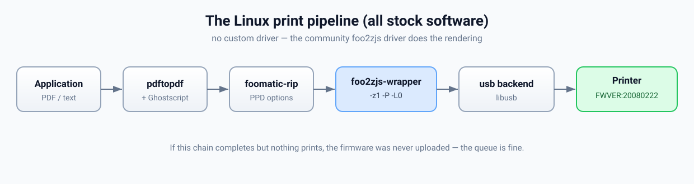
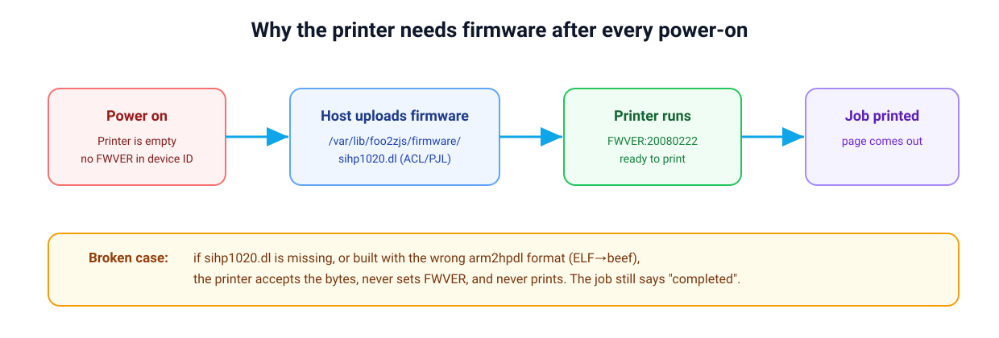
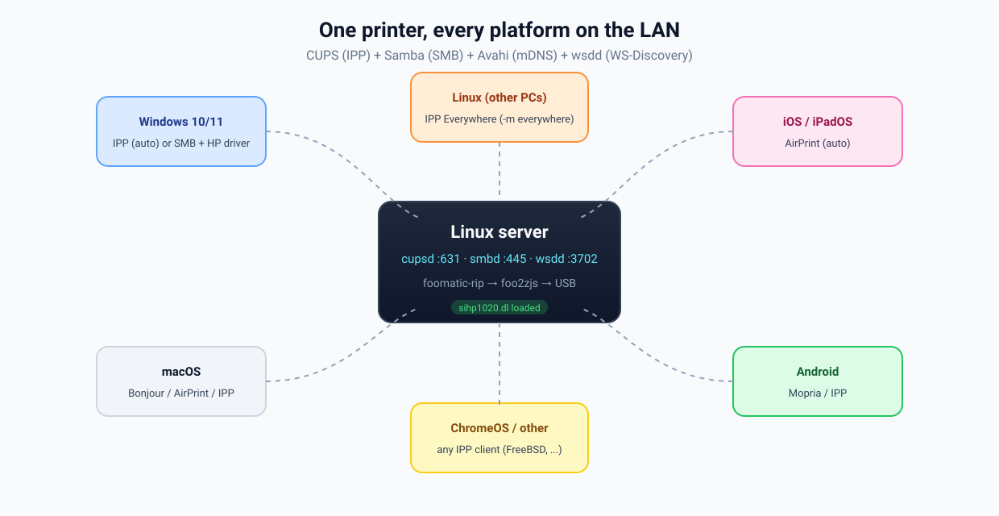
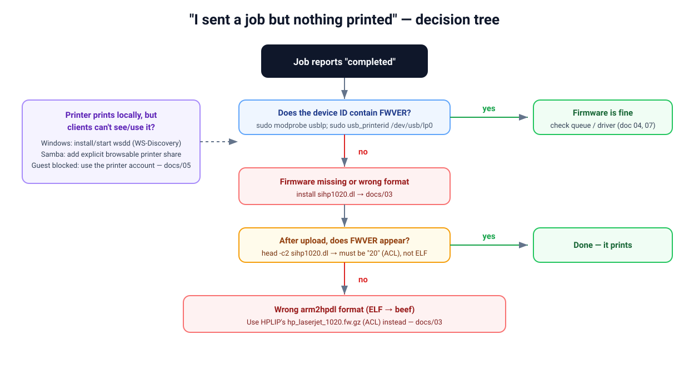

# HP LaserJet 1020 on Linux — print it, share it with everything

[](https://github.com/Orthodox2000/hp-laserjet-1020-linux/actions/workflows/lint.yml)
[](LICENSE)

Fix and fully document the classic problem:

> The print job says **"completed"** in CUPS, the log says **"Sent N bytes"**, but the
> printer **never puts out a page.**

This repo explains **why** that happens and provides an idempotent script + docs to make the
HP LaserJet 1020 (and close relatives) print reliably on Linux, then share it to Windows,
macOS, iOS, Android, FreeBSD and anything else on the LAN.

Tested on: **Linux Mint 22.3 (Ubuntu 24.04 "noble"), CUPS 2.4.7, foo2zjs 20200505dfsg0,
Samba 4.19.5, HPLIP 3.23.12**, printer on USB.

---

## TL;DR — the 30-second explanation

The HP LaserJet 1020 is a **host-based (GDI) printer with no firmware inside it**.
Every time it is powered on, the PC must upload a firmware blob (`sihp1020.dl`) into the
printer's RAM **before it can render anything**. If the file is missing (or in the wrong
format), the driver happily sends data, the job reports success, and the printer silently
does nothing.

- The **driver** was never the problem. It's the normal open-source `foo2zjs` package.
- The **firmware** was missing. That's the fix.
- A second trap: `arm2hpdl` produces **two different output formats** (`beef`/ELF vs
  `ACL`/PJL). Only **ACL/PJL** works on the 1020.
- The reason the firmware is hard to get: upstream `getweb`'s only mirror is dead — see
  [OpenPrinting/foo2zjs#33](https://github.com/OpenPrinting/foo2zjs/issues/33). This repo
  bundles the correct firmware.

Details: [`docs/03-firmware.md`](docs/03-firmware.md).

---

## Quick start

```bash
git clone https://github.com/Orthodox2000/hp-laserjet-1020-linux
cd hp-laserjet-1020-linux

# 1) Install the driver + firmware for a local USB printer
sudo bash scripts/install-firmware.sh

# 2) Create the CUPS queue and (optionally) share it to the LAN
sudo bash scripts/restore-printer-and-shares.sh
```

Then verify:

```bash
lpstat -p -d
sudo modprobe usblp; sudo usb_printerid /dev/usb/lp0   # expect ...FWVER:20080222;
lp -d "$(lpstat -d | awk '{print $NF}')" /usr/share/cups/data/default-testpage.pdf
```

---

## How it works





---

## Cross-platform: one printer, every device



The host is the **only** machine that needs `foo2zjs` + the firmware. Everyone else speaks
**IPP** (a vendor-neutral standard) or SMB, so there is no per-OS driver port to maintain.

| OS / device | Discovery | Connection | Driver on client |
|---|---|---|---|
| Windows 11 | IPP + mDNS | `http://<ip>:631/printers/<q>` | none (IPP class) |
| Windows 10 | IPP + mDNS | `http://<ip>:631/printers/<q>` | none (IPP class) |
| Windows (SMB raw) | WSD | `\\<ip>\HP-LaserJet-1020` | HP LJ1020 |
| macOS 11+ / older | Bonjour | auto (AirPrint) | none |
| iOS / iPadOS / visionOS | AirPrint | auto | none |
| Android | Mopria | auto or `ipp://...` | none |
| ChromeOS | IPP | `ipp://...` | generic |
| Linux (other PCs) | IPP + mDNS | `lpadmin -m everywhere` | none |
| FreeBSD / OpenBSD / NetBSD | IPP | `lpadmin -m everywhere` | none |
| Solaris / illumos / Haiku | IPP | print dialog / `lpadmin` | none |

Full instructions and a larger matrix: [`docs/06-cross-platform.md`](docs/06-cross-platform.md).

---

## What's in here

| Path | What it is |
|------|------------|
| [`docs/README.md`](docs/README.md) | Documentation index |
| [`docs/01-symptoms.md`](docs/01-symptoms.md) | What "broken" looks like (and what it does *not*) |
| [`docs/02-diagnosis.md`](docs/02-diagnosis.md) | Reading the USB device ID / `FWVER` |
| [`docs/03-firmware.md`](docs/03-firmware.md) | Host-based printers, `sihp1020.dl`, the `arm2hpdl` format trap |
| [`docs/04-cups-queue.md`](docs/04-cups-queue.md) | The foo2zjs queue, PPD, device URI and filter chain |
| [`docs/05-windows-sharing.md`](docs/05-windows-sharing.md) | CUPS IPP + Samba + WS-Discovery (`wsdd`) |
| [`docs/06-cross-platform.md`](docs/06-cross-platform.md) | Windows / macOS / Linux / iOS / Android / ChromeOS / BSD |
| [`docs/07-troubleshooting.md`](docs/07-troubleshooting.md) | Every symptom we hit and its cause/fix |
| [`docs/08-migration.md`](docs/08-migration.md) | Moving the whole setup to a fresh install |
| [`docs/09-windows-driver.md`](docs/09-windows-driver.md) | HP's Windows driver per Windows version |
| [`docs/10-other-distros.md`](docs/10-other-distros.md) | Fedora/RHEL, Arch, openSUSE, NixOS, Gentoo, Alpine |
| [`docs/11-bsd-and-others.md`](docs/11-bsd-and-others.md) | FreeBSD / OpenBSD / NetBSD / other hosts |
| `scripts/install-firmware.sh` | Installs/converts the firmware and wires up auto-load |
| `scripts/restore-printer-and-shares.sh` | One-shot: queue + firmware + LAN/SMB sharing |
| `config/` | `smb.conf`, reference `cupsd.conf`, exact working PPD |
| `systemd/` | `wsdd.service` unit + Samba mount dependencies |
| `firmware/sihp1020.dl` | The working firmware (ACL/PJL, 128999 bytes) |
| `assets/` | SVG diagrams (banner, pipeline, firmware flow, sharing, decision tree) |

---

## Troubleshooting at a glance



Full field guide: [`docs/07-troubleshooting.md`](docs/07-troubleshooting.md).

---

## Reporting / upstream status

The reason `getweb` cannot fetch firmware anymore is tracked upstream:

- **[OpenPrinting/foo2zjs#33](https://github.com/OpenPrinting/foo2zjs/issues/33)** —
  `getweb`'s only mirror (`quirinux.org`) is unreachable.
- **Ubuntu Launchpad [#1382606](https://bugs.launchpad.net/ubuntu/+source/foo2zjs/+bug/1382606)** —
  "foo2zjs doesnt automatically download firmware for LJ 1000/1005/1008/1020 etc." (open).

This repository is the documented workaround and bundles the correct firmware.

---

## Firmware notice

`firmware/sihp1020.dl` is **HP's proprietary firmware**, redistributed here for
interoperability because it is required to operate hardware you own. It is the same blob
HPLIP ships (`hp_laserjet_1020.fw.gz`) and that `foo2zjs` uploads. If you would rather not
use the bundled copy, [`docs/03-firmware.md`](docs/03-firmware.md) shows how to regenerate it
from your own printer/HPLIP installation.

The scripts and documentation are MIT-licensed (see [`LICENSE`](LICENSE)).

---

## Credits

- The [foo2zjs](https://github.com/OpenPrinting/foo2zjs) project (Rick Richardson, OpenPrinting)
  — the actual driver.
- HPLIP, which supplies the firmware blob.
- Samba, CUPS and `wsdd` for the sharing stack.
